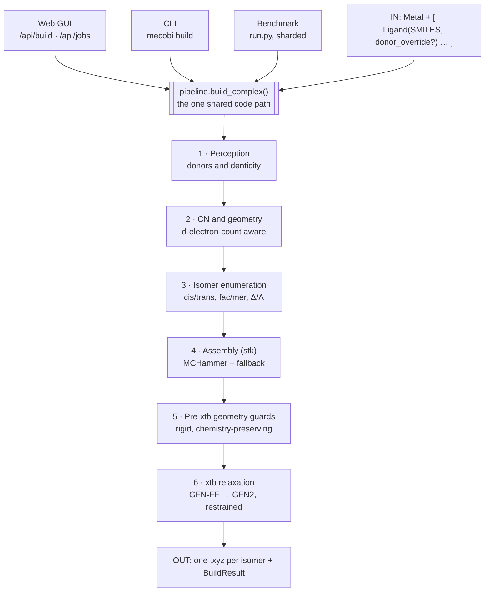

# How MeCoBi Works

MeCoBi turns the SMILES of a metal complex's ligands into an optimised 3D structure of the
assembled complex — one local chemistry engine that the command line, the web GUI, and the
structural benchmark all drive through the same code path.

> `SMILES → pydentate (donors, denticity) → CN → geometry → isomer enumeration → stk assembly →
> MCHammer → pre-xtb guards → xtb → .xyz`

This document is a reference for how the builder works end to end. For repo layout, commands and
the isomer notation see [`README.md`](README.md).

---

## 1. What MeCoBi is

MeCoBi assembles a **mononuclear** coordination complex — one metal centre — from the 2D SMILES of
its ligands and produces a relaxed 3D `.xyz`. You give it a metal, an oxidation state, and the
ligands; it works out which atoms coordinate, how many, the coordination geometry, the distinct
isomers, places every ligand on the polyhedron, cleans up the raw placement, and hands the result
to `xtb` for a semi-empirical quantum relaxation.

The whole chemistry stack runs **locally**. Three surfaces sit on top of it — a command line, a
browser GUI, and a research benchmark — but none of them contains any chemistry of its own. They
differ only in how a job is described and where the result goes.

**Three architecture invariants keep the system honest:**

- **The core package (`src/mecobi/`) has ZERO web dependencies.** Every chemistry module runs with
  no web dependency; FastAPI/uvicorn live behind an optional `[web]` extra and are never imported by
  the core.
- **One shared code path.** CLI, GUI and benchmark all call `pipeline.build_complex()`. There is
  exactly one place where a complex becomes a structure — no forked logic to drift.
- **The frontend ships as a committed build.** The React/Vite app is compiled and committed into
  `src/mecobi/web/static/`, so running the GUI needs no Node. CI enforces that a fresh build
  byte-matches the committed bundle.

---

## 2. The pipeline at a glance

A single call — `pipeline.build_complex(complex, output_dir, …)` — carries a complex through the
stages below. The three front-ends converge on it; everything after is shared.



---

## 3. Input & perception

A build starts from a `Complex`: one `Metal(symbol, oxidation_state)` and a list of `Ligand`s. A
counter-ion-stripped ligand list is fine — but the **oxidation state must be real**, because it
drives the d-electron count and therefore the geometry (below).

**Perception** (`perception.perceive`) decides, per ligand, which atoms bind the metal and the
*denticity*, by a strict precedence:

1. **Explicit donor override** — the atom indices are pinned (the GUI's donor-correction panel, or
   the benchmark's ground-truth donor list).
2. **Declared η-arene / Cp** — a carbocyclic cap, denticity fixed.
3. **Single-atom ligand** — a halide, trivially monodentate.
4. **Conservative arene / Cp detection** — an anionic `[c-]` cyclopentadienyl or an aromatic
   carbocycle.
5. **pydentate** — a graph-neural-net model predicts donors for anything left.

Two chemistry conventions shape the count:

- **π-hapticity**: an η²-alkene or η²-alkyne is *one* coordination site at the bond midpoint (a
  2-atom donor group), and a chelating diene like COD is two such sites — so `Pt(COD)Cl₂` is CN4,
  not CN6.
- **η-cap** (Cp, arene): one site at the ring centroid, so a metallocene is a linear 2-coordinate
  build.

**Perception repairs baked in from CSD-mining experience:**

- A **chelating diene** whose donors were mined as the saturated CH₂ carbons (a COD-index mismatch
  between two SMILES traversals) is snapped to its alkene carbons, so the η² sites are recovered.
- A **terminal η²-alkyne** mined as an acetylide anion (`[C-]#C–R`) is re-protonated to the neutral
  alkyne, restoring the terminal C–H (ligand charge −1 → 0).

---

## 4. Coordination number, geometry & isomers

The coordination number is the sum of ligand denticities. The geometry
(`geometry.propose_geometry`) is **d-electron-count aware**: the d-count comes from
`spin.d_electron_count = group − oxidation_state`, and it splits the ambiguous CNs.

| CN       | Rule                                     | Geometry                          |
|----------|------------------------------------------|-----------------------------------|
| 2, 3, 6  | d-count independent                      | linear · trigonal · octahedral    |
| 4        | d8                                       | square planar                     |
| 4        | otherwise                                | tetrahedral                       |
| 5        | d8 / d10                                 | trigonal bipyramidal              |
| 5        | otherwise                                | square pyramidal                  |
| any      | main-group ns² lone pair (Bi³⁺, Sn²⁺…)   | symmetry lowered (VSEPR)          |

> **Feed a real oxidation state.** Deriving the OS by ligand-charge balance on a counter-ion-stripped
> SMILES yields 0 → d10 → everything tetrahedral, which is wrong for Ni/Pd/Pt(II). The OS is an
> input, not something to infer.

### The site model

Coordination sites are numbered `0 … CN-1` on **fixed axes**, shared identically by the text isomer
notation and the 3D scene. For an octahedron:

```
SITE_VECTORS (octahedral)
0:+x   1:−x   2:+y   3:−y   4:+z   5:−z     # trans = the opposite pair on an axis
```

An **isomer** is a donor→site assignment on this fixed frame, so it captures cis/trans, fac/mer and
Δ/Λ exactly. A build either enumerates the distinct isomers (`isomers.enumerate_site_isomers`),
takes a single canonical one (`assembly.default_isomer`, which routes a meridional pincer to the
site model instead of a facial piano-stool), or builds a specific one from a supplied site-map /
notation string.

---

## 5. Assembly & the MCHammer fallback

Assembly (built on [stk](https://stk.readthedocs.io)) places every ligand on the chosen polyhedron.
The metal is a building block of `SingleAtom` functional groups; each ligand exposes one functional
group *per coordination site* — a σ-donor is a 1-atom bonder, an η²-alkene a 2-atom bonder seated at
the midpoint, an η-cap a centroid bonder.

Two routes exist:

- a hand-tuned **fixed registry topology** for common partitions, and
- a **dynamic site model** (`build_from_sites`) that honours an arbitrary donor→site map — the
  latter also pins flexible high-denticity wrappers and η²-diene bites to their target sites with a
  coordinate-map embed (so COD folds to its bound **boat**, not a chair).

stk's optimiser then relaxes the raw vertex placement. By default that is **MCHammer** (target
M–L ≈ 2.1 Å); but MCHammer can *collapse* a sphere — squeezing small monodentate halides together,
or distorting a clean octahedron. So the build scores the result:

> **`_geom_badness` → `_build_with_fallback`.** A penalty flags a non-donor atom on the metal, a
> donor at an impossible M–L distance, two ligands fused, two **different-ligand donors** collapsed
> together, or a large angular deviation from the ideal polyhedron. If MCHammer's result is worse
> than the raw `NullOptimizer` placement, the pipeline hands xtb the **ideal-site placement**
> instead. `mchammer=False` turns MCHammer off entirely.

---

## 6. Pre-xtb geometry guards

Assembly can leave an artefact that a blind quantum optimiser would only entrench. A layer of
**rigid, chemistry-preserving** fixes cleans the sphere first — each one measures the geometry, acts
only when a defect is present, and keeps its move only if it demonstrably improves the structure
(never a net loss). Donors stay on their sites throughout.

| Guard | Function | What it does |
|---|---|---|
| Reposition stranded donors | `reposition_stranded_monodentates` | Slide a monodentate pushed out by a bulky neighbour back along the M–donor line to its CSD reference bond length. |
| Bonders-closest / cone reseat | `orient_monodentate_body_outward` | Rotate a ligand about its donor so the bonders are the atoms nearest the metal — reseating a σ-aryl cone that folded onto the centre (aligning the α-shell / lone-pair axis outward). |
| Axial de-clash | `declash_monodentate_torsion` | Spin crowded bulky monodentates about their own M–donor axis so their arms mesh instead of interpenetrating — rigid, so no bond can break. |
| Bulky UFF de-clash | `declash_bulky_monodentates` / `ff_declash` | A metal-excluded UFF relax of the ligand shell, donors pinned; kept only if inter-ligand overlap drops and no bond deforms. `ff_declash` (`--ligand-ff-preopt`) is opt-in. |

A metal whose GFN2 diverges (Y) can be relaxed as an xtb-friendly surrogate of the same charge and
d-count (Sc(III) for Y(III)) and restored afterwards; f-block centres skip xtb entirely and return
the assembled geometry.

---

## 7. xtb relaxation & restraints

The cleaned structure is relaxed with `xtb` in two stages — a **GFN-FF** pre-relax gently relieves
remaining clashes, then **GFN2** refines the quantum geometry. Charge and spin are always passed
(`--chrg` from the total charge, `--uhf` from the spin state). xtb is deliberately left free to
re-form a bond that a bad initial placement needs; any connectivity change is detected and flagged
(`connectivity_ok`).

A gas-phase optimisation has no crystal packing, counter-ion or solvent to hold labile donors in
place, so a `$constrain` block preserves the intended coordination. Each restraint answers a
specific failure mode:

| Restraint | Holds | Prevents |
|---|---|---|
| M–L distance | each bond near its `ml_reference.json` (CSD → covalent) target | a labile donor drifting off the metal; halved the bond RMSD |
| Intramolecular bonds | each ligand bond near its assembled length | xtb pulling a ligand apart |
| Linear donor 180° | an end-on CO / CN⁻ / nitrosyl collinear | an end-on donor bending inward and clashing |
| Planar donor (dihedral) | an sp² N/O coplanar with the metal | a pyridine/phenol bending pseudo-sp³ out of plane |
| Hapticity pins | a σ-aryl carbon's ortho distances | an aryl carbanion slipping to η⁶-arene |
| Terminal oxo / nitrido | *free* — deliberately unrestrained | over-restraining a genuine short M=O / M≡N multiple bond |

**Anti-fusion (detect-then-fix).** If xtb forges a *new* bond between two donors of different
ligands (two cis carbonyls → C–C, an oxo onto a thiolate, an iodide onto an amide) — a fusion the
plain relax can't undo — the build re-relaxes **once** from the assembled geometry with distance
floors on exactly those pairs, and keeps it only if the fusion cleared. A second xtb runs only for
the few % that actually fuse (self-selecting via the connectivity guard); a sphere that relaxed
clean is never touched, so it can't distort a good geometry.

Each isomer is relaxed and ranked by energy; the output is one `.xyz` per isomer plus a
`BuildResult` carrying the donor indices, total charge, spin, energy, any warnings, and a
connectivity check. The lowest-energy isomer is marked.

> **Possible-missing-hydride flag.** X-ray CIFs seldom locate M–H, so a hydrido complex arrives with
> its CN too low. `spin.possible_missing_hydrides` flags the 18-electron shortfall (16e for a d8
> centre) as a build warning, so the user knows the sphere may be incomplete.

---

## 8. Using the GUI

The browser app is a thin orchestration layer over the same pipeline — a FastAPI server with a
committed React/Vite frontend. Start it and open `127.0.0.1:8000`:

```bash
python -m uvicorn mecobi.web:app --port 8000        # serves the built GUI + API
# frontend dev only: cd frontend && npm run dev  (proxies /api to :8000)
```

**The working loop:**

1. **Describe the complex** — pick a metal + oxidation state and paste ligand SMILES (or upload a
   CSV, or press *Load sample* for one of five real metallodrugs: cisplatin, titanocene dichloride,
   TLD1433, ferroquine, BOLD-100).
2. **Perceive** (`/api/parse`, `/api/perceive`) — the server returns each ligand's perceived donors,
   denticity, charge and a 2D depiction (`/api/depict`). Wrong donors are corrected by hand, which
   becomes a donor override.
3. **Choose the isomer** — site figures generated from `SITE_VECTORS` (`/api/vertices`,
   `/api/sites`) show the numbered polyhedron, so an assignment is picked visually; the figures
   cannot drift from the code that builds.
4. **Build** — a quick job runs synchronously (`/api/build`); a heavy one is queued (`/api/jobs` →
   poll `/api/jobs/{id}`).
5. **Inspect & export** — the relaxed structure renders in a 3Dmol viewer with the metal–donor bonds
   drawn; download the `.xyz`.

A **reverse** path (`/api/reverse*`) recovers metal + ligand SMILES, an isomer notation, a
MetalloGen m-SMILES (built in; geometry + site-labelled donors, so it fixes the isomer), or (via
optional MIT extras) a whole-complex SMILES or T-REX string from an uploaded `.xyz`. The public
instance at <https://mecobi.york.ac.uk> ships all of them. The public API
carries resource limits, rate limiting, xyz-size checks and collision-safe output filenames —
app-level guards, not a substitute for deployment sandboxing.

---

## 9. Using the CLI

The command line drives the identical pipeline over a CSV. The columns are `Metal, Charge, L1…L6,
Name, Index` (an optional `Isomer` column pins the isomer notation); repeated ligands appear as
repeated columns — there is no count field.

The `Isomer` CSV column is supported by the CLI/core parser; pinned donors override
perception. The web GUI has no notation input (donors via the donor panel, sites via
the 3D Assign scene) and ignores an `Isomer` column in uploaded CSVs.

```bash
# build every complex in a CSV, writing one .xyz per isomer
mecobi build complexes.csv --output-dir ./out
mecobi build complexes.csv --all-isomers        # enumerate every isomer
mecobi build complexes.csv --no-relax           # assembly + MCHammer only, skip xtb
mecobi build complexes.csv --xtb-bin /path/to/xtb
mecobi build complexes.csv --format xyz,mol,pdb # also .mol/.pdb with explicit M-L bonds

# recover the inputs from a structure
mecobi reverse complex.xyz --notation
mecobi reverse complex.xyz --charge 0 --msmiles
mecobi reverse complex.xyz --backend xyz2mol_tm --charge 0
mecobi reverse complex.xyz --charge 0 --trex
```

Each built path prints with its relative energy and a `*lowest*` marker; per-complex warnings (a
radical ligand, a possible missing hydride, a guard that fired) go to stderr. `xtb` is only needed
when relaxation is on — a `--no-relax` build works without it.

---

## 10. The structural benchmark

The benchmark (`experiments/benchmark/`) scores MeCoBi's builds against **experimental crystal
structures** — roughly 30 000 mononuclear complexes mined from the CSD. It answers one question at
scale: how close is a built coordination sphere to the one nature crystallised?

### Frozen inputs

| File | Holds |
|---|---|
| `benchmark_bundle_v2.json` | the MetaLig-style build inputs per refcode — metal, oxidation state, CN, ligand SMILES, charges, donor elements |
| `benchmark_donors.json` | ground-truth donor atom indices per ligand — bypasses pydentate so a run isolates the *builder* from perception |
| `benchmark_spheres.json.gz` | the experimental coordination sphere per refcode — metal position + donor positions (CSD coordinates: not distributed, regenerated from the CIFs; see `experiments/benchmark/README.md`) |
| `benchmark_targets_*.json` | per-refcode target geometry, continuous-shape measure, and the crystal's donor→site map (the exact isomer to build) |
| `benchmark_overrides.json` | per-refcode input corrections (confirmed OS/charge/donor errors in the frozen bundle), applied without editing the immutable bundle |

### The runner

`run.py` is shardable and resumable. For each complex it builds from the MetaLig inputs, applies the
chosen relax-strategy flags, xtb-relaxes, then scores the relaxed sphere against the crystal sphere;
it writes per-complex JSONL that `aggregate.py` combines into the results table. The relax strategy
is entirely flag-driven, so any guard can be A/B'd:

```bash
# one of 32 shards, ground-truth donors, a specific isomer per crystal
python run.py --shard 0/32 --bundle benchmark_bundle_v2 --donors benchmark_donors.json \
    --spheres benchmark_spheres.json.gz --targets pilot100/benchmark_targets_pilot2.json
# A/B a guard
python run.py --no-mchammer            # ideal-site placement, never MCHammer
python run.py --no-planar-guard        # let sp2 donors bend, to measure the guard
```

The compute-heavy xtb runs are executed by a collaborator on a Linux cluster; the harness and the
frozen bundle are the shared contract.

**Defaults worth knowing** (see *What runs by default* below): `--bundle` defaults to the **v1**
bundle, `--donors` to `None` (uses pydentate, not the ground-truth donors), and `--targets` to
`None` (heuristic isomer, not the crystal site-map). Pass all three to run the deterministic v2
benchmark.

### The metrics (`metrics.py`)

Each build is compared to its crystal on several complementary axes, so a single flaw can't hide
behind a good average:

| Metric | What it measures |
|---|---|
| CN match | did the build reach the crystal's coordination number |
| shape + CShM | the build/crystal polyhedron vs the ideal shape, as a label and a continuous shape measure |
| poly_cshm | the build polyhedron directly against the crystal polyhedron — label-free, fair where the ideal shape is ambiguous |
| dmat_rmsd | RMSD of the donor–donor distance matrix |
| bond_rmsd | metal–donor bond-length RMSD (+ a signed radial offset) |
| c-kmRMSD | the depth-2 coordination core, matched with Kuhn–Munkres + Kabsch and de-duplicated across symmetry images |

Because MeCoBi counts an η-cap as one site while a crystallographic CN counts every M–C contact, the
angular metrics are scored on **hapticity-collapsed** spheres — caps reduced to their centroids on
both sides, like for like — so free ring rotation isn't penalised. When the crystal site-map's site
count no longer matches the perceived denticities (a COD counted as 4 carbons but perceived as 2 η²
sites), the stale map is dropped and MeCoBi picks the geometry itself (CN4 square planar).

### Known data-quality caveats (source, not builder)

The mined inputs carry systematic gaps the builder cannot invent away, all documented rather than
silently absorbed:

- **Hydrides are absent** in every one of the 35 956 entries (X-ray CIFs seldom locate M–H), so a
  hydrido complex arrives with its CN too low — now surfaced by a *possible-missing-hydride* warning.
- A subset of **COD donors** were indexed to the saturated carbons — repaired in perception.
- A subset of **η² alkynes** were mined as acetylides — re-protonated in perception.

### Report

`pilot100/compare_tools_html.py` builds a self-contained review HTML of a comparison run, with 3D
viewers of each build next to the crystal. The metal–donor bonds in the viewer are drawn to the
**actual bonder atoms** (`run.py` records `donor_indices`; `backfill_donor_indices.py` backfills
them into an older run's JSONL without re-running xtb).

---

## 11. Architecture & key files

| Path | Role |
|---|---|
| `pipeline.py` | the one entry point — orchestrates every stage, wires the xtb restraints |
| `perception.py` | donors, denticity, π-hapticity, the CSD-data repairs |
| `geometry.py` · `spin.py` | d-count-aware geometry; d-electron count, spin, the hydride-shortfall flag |
| `isomers.py` · `assembly/` | isomer enumeration; the site model, stk topologies, MCHammer fallback |
| `optimize.py` | the geometry guards, the xtb restraint machinery, `relax_with_xtb` |
| `data/ml_reference.json` | the mined CSD metal–donor bond-length table (`metal\|OS\|donor\|CN`) |
| `web/app.py` · `web/static/` | the FastAPI layer and the committed frontend build |
| `reverse.py` · `msmiles.py` | xyz → SMILES / isomer notation / m-SMILES (built in) / Complex SMILES & T-REX (optional extras) |
| `experiments/benchmark/` | the runner, frozen bundle, metrics and scoring |

---

## Appendix — what runs by default in `run.py`

**ON by default:** `--two-stage`, `--reposition-donors`, `--clear-metal-region`, `--declash-torsion`,
`--orient-bulky`, `--haptic-guard`, `--planar-guard`, `--linear-restraint`, `--coord-map`,
`--mchammer`, `--mchammer-fallback`, `--antifusion`.

**OFF by default (opt-in):** `--ligand-ff-preopt` (the RDKit UFF de-clash explodes crowded/high-CN
spheres), `--metal-surrogate` (Y→Sc), `--uff-fallback`, `--revert-topology`, `--registry-topology`.

**Other defaults:** `--bundle benchmark_bundle` (**v1** — pass `benchmark_bundle_v2` for v2),
`--donors None` (uses pydentate, not the ground-truth donors), `--targets None` (heuristic isomer),
`--xtb-timeout 180`, `--conformer-ensemble 1`, `--shard 0/1`.
