<p align="center">
  
</p>

# MeCoBi — Metal Complex Builder

Turn SMILES strings of metal-complex **ligands** into optimised 3D structures
(`.xyz`) of the assembled complex.

**Try it online:** <https://mecobi.york.ac.uk> (the deployed commit is shown in the
page footer and at `/api/version`).

Pipeline: `SMILES → pydentate (donor atoms, denticity) → coordination number →
geometry → isomer enumeration → stk assembly → MCHammer → xtb → .xyz`.

For how the builder works end to end, see
[`MECOBI_HOW_IT_WORKS.md`](MECOBI_HOW_IT_WORKS.md); to get started, see
[`QUICKSTART.md`](QUICKSTART.md) and the notebook
[`examples/mecobi_quickstart.ipynb`](examples/mecobi_quickstart.ipynb).

## Product shape

Two deliverables on **one shared core**:

1. **`mecobi` core package** — the real product. All chemistry, zero web deps,
   runs fully locally. Importable library + `mecobi` CLI.
2. **Web service** — thin FastAPI + React orchestration layer over the same
   core. No chemistry in the web layer; local and web share one code path.

## Repository layout

```
src/mecobi/            # core package (this repo's product)
  model.py             # data model: Metal, Ligand, Complex, Geometry, Spin
  inputs.py            # CSV / direct spec -> Complex
  perception.py        # pydentate wrapper: donor atoms, denticity, arene rule
  geometry.py          # CN -> geometry registry (hard-errors on mismatch)
  spin.py              # spin state -> uhf for xtb
  isomers.py           # isomer enumeration + donor-index isomer notation (mode 3)
  assembly/            # stk topology graphs + build()
    topologies/        # custom stk graphs (one fixed arrangement each)
    sites.py           # numbered coordination sites -> exact-isomer topologies
    registry.py        # (geometry, denticities) -> topology lookup
  chelate_fix.py       # assembly-time repair of inside-out 5-membered chelates
  joint_embed.py       # joint re-embedding of crowded spheres
  optimize.py          # MCHammer -> geometry guards -> xtb (always --chrg / --uhf)
  data/ml_reference.json  # CSD-mined M-L bond-length table (xtb restraints)
  naming.py            # charge / isomer filename conventions
  export.py            # extra output formats (.mol, .pdb)
  pipeline.py          # end-to-end orchestration (the single code path)
  reverse.py           # .xyz -> per-ligand / whole-complex SMILES / T-REX / m-SMILES
  msmiles.py           # MetalloGen site table + shape fit for m-SMILES
  cli.py               # `mecobi build ...` / `mecobi reverse ...`
  web/                 # FastAPI app, job queue, request limits; serves the frontend build
  _pydentate/          # vendored pydentate (MIT, licence preserved)
frontend/              # React + Vite source of the GUI
tests/
examples/              # quickstart notebook (the scripted counterpart of the GUI)
experiments/benchmark/ # CSD structural benchmark (harness, inputs by refcode, metrics)
experiments/paper/     # results and scripts behind the paper's figures and tables
Dockerfile             # the image behind mecobi.york.ac.uk
```

## Supported coordination environments

The core currently supports coordination numbers **2–9**. Where a coordination
number has common alternatives, the GUI and API offer them as choices rather
than silently selecting one:

| CN | Geometry / geometries |
|---:|---|
| 2 | linear |
| 3 | trigonal planar |
| 4 | square planar; tetrahedral |
| 5 | trigonal bipyramidal; square pyramidal |
| 6 | octahedral |
| 7 | pentagonal bipyramidal |
| 8 | square antiprism; dodecahedral |
| 9 | tricapped trigonal prism |

η-Ligands (Cp/arene caps) are handled through the coordinating-atom selection: a
carbocyclic 5-/6-ring picked as the donor becomes **one coordination site at its
ring centroid** (an η-cap, denticity 1), so its ring atoms don't inflate the
coordination number. This builds metallocenes (ferrocene → CN 2 linear), bent
metallocenes (Cp₂TiCl₂), sandwiches and half-sandwiches (e.g. (arene)Cr(CO)₃),
and mixed cap+σ ligands such as an ansa-metallocene or a Cp+pyridine
constrained-geometry catalyst. Ordinary metallocenes and sandwiches — where each
Cp/arene is a **separate** ligand (ferrocene, titanocene dichloride) — perceive
correctly and build automatically. Only when a **single** ligand carries two Cp
rings (an ansa-metallocene, a Cp+pyridine ligand) does auto-perception see just
one ring: select both in the donor panel (batch "Build all" skips these until you
do). CN 10 and above are not yet supported.

## Coordination-site numbering & the isomer notation

Every geometry numbers its coordination **sites** `0 … CN-1`. This one numbering
is shared by the 3D "Assign" scene in the web GUI **and** the text isomer
notation below (they are the same ids), so a site you click in 3D is the same
number you type. The figures are generated directly from `SITE_VECTORS` by
[`scripts/gen_site_figures.py`](scripts/gen_site_figures.py) — rerun it when a
geometry changes so they cannot drift from the code.

| | | | |
|:--:|:--:|:--:|:--:|
| 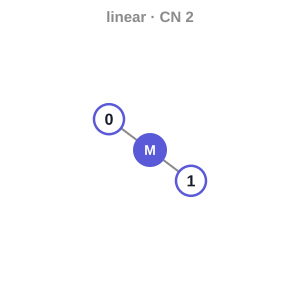 | 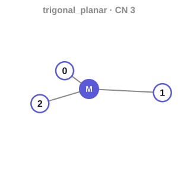 | 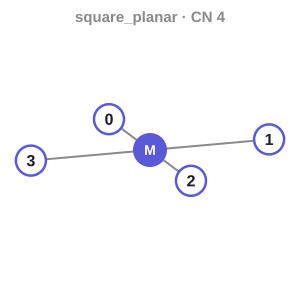 | 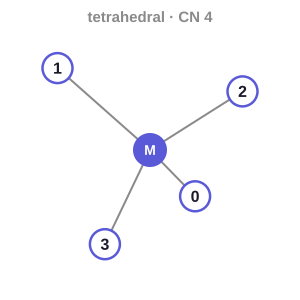 |
| 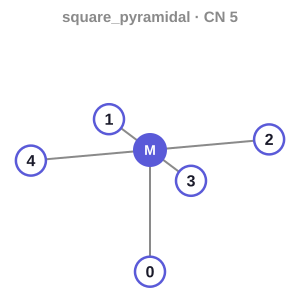 | 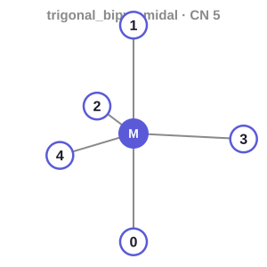 | 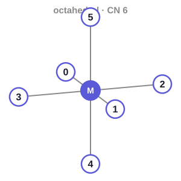 | 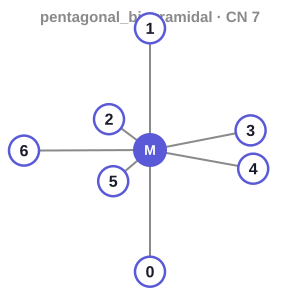 |
| 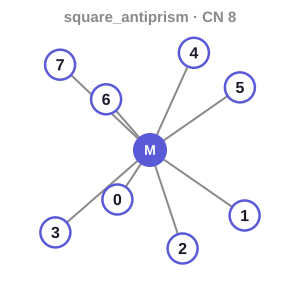 | 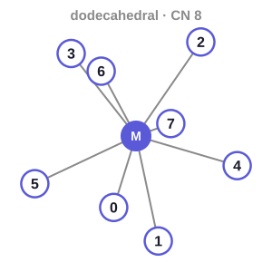 | 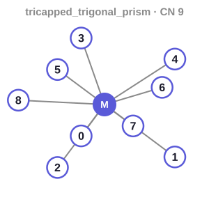 | |

The site axes are fixed (e.g. octahedral `0`=+x `1`=−x `2`=+y `3`=−y `4`=+z
`5`=−z), so **trans** sites are the opposite pair on an axis and everything else
is **cis**:

| Geometry | trans (opposite) pairs |
|---|---|
| square planar | (0,2), (1,3) |
| octahedral | (0,1), (2,3), (4,5) |

### Isomer notation ("mode 3")

Build one specific isomer by pinning, per ligand, which SMILES atoms coordinate
and/or which site each donor takes. One string per complex; ligand blocks are
`;`-separated:

```
[geometry|]  ligIdx[(donorAtoms)][:sites] ;  ligIdx...
```

- `ligIdx` — the ligand, 0-based in the row's order (L1 = 0, L2 = 1, …).
- `(donorAtoms)` — *optional* 0-based heavy-atom indices of that ligand's SMILES
  that coordinate (omit to let perception decide).
- `:sites` — *optional* site ids from the figures above, in donor order; a
  bidentate lists two **cis** sites. Omit to let MeCoBi choose/enumerate.

**CLI / core CSV parser:** provide a **double-quoted** `isomer` column (the
notation can contain commas). Pinned donors override pydentate perception, so this
is how crystal-structure donors reach a batch or benchmark run.

**Web GUI:** there is no notation input. Pick donors in the row's donor panel and
assign sites in the 3D **Assign** scene; an `isomer` column in pasted or uploaded
GUI input is ignored. Results can still be exported as SMILES + notation.

Examples:

```csv
Metal,Charge,L1,L2,L3,L4,isomer
Pt,2,N,N,[Cl-],[Cl-],"0:2;1:3;2:0;3:1"                                  # square-planar cis-Cl
Pt,2,N,N,[Cl-],[Cl-],"0:1;1:3;2:0;3:2"                                  # square-planar trans-Cl
Ir,3,c1ccc(-c2ccccn2)nc1,c1ccc(-c2ccccn2)nc1,[Cl-],[Cl-],"0:0,2;1:3,5;2:1;3:4"   # octahedral cis-Cl
Y,3,CC(C)c1cccc(C(C)C)c1[N-]C=C[N-]c1c(C(C)C)cccc1C(C)C,C=C=C(C(=NC1CCCCC1)[N-]C1CCCCC1)c1ccccc1,C1CCOC1,,"0(12,15);1(4,11);2(3)"   # donors only (CSD LAYFID): amidinate N4,N11, not the allene
```

Tip: run `mecobi reverse some.xyz --notation` on any structure to read back a
valid notation string for that exact arrangement.

## Environment

New here? **[`QUICKSTART.md`](QUICKSTART.md)** is a copy-pasteable, from-scratch
terminal walkthrough (clone → install → first build → isomer notation → reverse →
web GUI). For the same workflow from Python (build, donor/geometry/isomer
options, xTB relaxation, batch, reverse conversion, 3D views), run the notebook
[`examples/mecobi_quickstart.ipynb`](examples/mecobi_quickstart.ipynb). The condensed version:

Python 3.11-3.14 (CI runs the test suite on all four; the Docker image uses
3.12). All Python dependencies (rdkit, torch, stk, stko, MCHammer)
install via pip; **xtb is a compiled binary** and comes from conda-forge
(`conda install -c conda-forge xtb`). It is only needed when relaxation is
enabled — builds with relax off work without it. For results that match CI and
the paper exactly, install with the lock: `pip install -e ".[web,dev]" -c
constraints.txt` (structures can differ slightly with other RDKit releases).

```
git clone https://github.com/TheFreiLab/MeCoBi.git
cd MeCoBi
pip install -e .
```

## Tests

```
pip install -e ".[dev]"
pytest -m "not slow"     # fast suite (~seconds)
pytest                   # includes tests that load the torch models / run xtb
```

## Run the web GUI (local)

```
pip install -e ".[web]"
python -m uvicorn mecobi.web:app --port 8000
# open http://127.0.0.1:8000  → paste a CSV (or "Load sample") → Parse → Build → view/download
```

The GUI is a **React + Vite** app (`frontend/`) whose production build is committed
into `src/mecobi/web/static/` and served by FastAPI — so running the GUI needs no
Node. To develop the frontend:

```
cd frontend && npm install
npm run dev          # http://localhost:5173, proxies /api to the backend on :8000
npm run build        # rebuilds into src/mecobi/web/static/ (commit the result)
```

Because both the source and the built bundle are committed, they can drift. CI
guards this: `scripts/check_frontend_build.sh` rebuilds from the pinned toolchain
(`npm ci` + Node from `.nvmrc`) and fails if the committed `src/mecobi/web/static/`
differs — run it locally before pushing frontend changes. Never hand-edit the
minified assets; regenerate with `npm run build` and commit.

## Continuous integration

| Workflow | Runs on | Checks |
|---|---|---|
| `python-tests` | every PR (Python 3.12); every push to `main` (3.11–3.14) | `ruff check .` + the fast suite against `constraints.txt` |
| `frontend-build-consistency` | PRs and `main` pushes touching the frontend or bundle | the committed bundle byte-matches a fresh build |
| `docker-build` | PRs touching the image, `src/`, `tests/` or the benchmark | builds the image, then: xtb runs, licence texts ship, the app builds a real structure end to end, every reverse representation answers, the regression suite (with xtb) passes, the container runs as non-root |

## Docker

The image bundles MeCoBi, the web extra, xtb (conda-forge) and the two optional
reverse backends. Build and run it locally:

```
docker build -t mecobi .
docker run -d --name mecobi -p 127.0.0.1:8000:8000 mecobi
```

The header of the [`Dockerfile`](Dockerfile) lists the resource limits, volume and
proxy settings the public deployment runs with.

## Credits & third-party licences

MeCoBi is MIT-licensed ([`LICENSE`](LICENSE), Copyright (c) 2026 The Frei Lab).
To cite MeCoBi itself, use the metadata in [`CITATION.cff`](CITATION.cff), which
GitHub renders as a "Cite this repository" button.

The full inventory of third-party material, separated by
whether we redistribute it (vendored code, the xtb binary in the Docker image) or
merely depend on it, is in
[THIRD_PARTY_NOTICES.md](THIRD_PARTY_NOTICES.md). Provenance of the bundled
CSD-derived bond-length table is in
[DATA_PROVENANCE.md](DATA_PROVENANCE.md); the table is published following CCDC
review (November 2026).

The 3D viewer is **3Dmol.js** (BSD-3-Clause, David Koes and contributors), pinned
and served from this application rather than fetched from a third-party host.

Ligand perception uses **pydentate** (Kulik Group, MIT licence,
<https://github.com/hjkgrp/pydentate>), vendored under
`src/mecobi/_pydentate/` (licence preserved there). If you use MeCoBi, please
cite:

- *Graph Neural Networks for Predicting Metal–Ligand Coordination of Transition
  Metal Complexes*, PNAS — [10.1073/pnas.2415658122](https://doi.org/10.1073/pnas.2415658122)
- *Identifying Dynamic Metal–Ligand Coordination Modes with Ensemble Learning*,
  JACS — [10.1021/jacs.5c17169](https://doi.org/10.1021/jacs.5c17169)

### Optional reverse-conversion backends

The `reverse` command / web "Get SMILES" control has two optional, metal-aware
backends (both MIT-licensed, imported lazily, **not** vendored — installed via the
`reverse-tm` extra: `pip install 'mecobi[reverse-tm]'`). If you use either, please
cite the corresponding paper:

- **xyz2mol_tm** — whole-complex xyz→SMILES (Jensen Group,
  <https://github.com/jensengroup/xyz2mol_tm>). *SMILES all around: structure to
  SMILES conversion for transition metal complexes*, J. Cheminform. 2025 —
  [10.1186/s13321-025-01008-1](https://doi.org/10.1186/s13321-025-01008-1)
- **trex** — geometry-aware T-REX notation (I. Kevlishvili,
  <https://github.com/iliak14/trex>). *Taming T-REX: A Canonical Language for
  Geometry-Aware Generative Design of Transition Metal Complexes*, ChemRxiv 2025 —
  [10.26434/chemrxiv-2025-7s3gx](https://doi.org/10.26434/chemrxiv-2025-7s3gx)

The production image (and so the public web GUI) installs both.

One further representation is built in and needs no extra: **m-SMILES**, the input
string of MetalloGen (`mecobi reverse some.xyz --charge 0 --msmiles`, or the web
representation menu). It names the closest MetalloGen geometry and labels every donor
(every atom of a haptic group) with its coordination-site number, so it fixes the
isomer as well as the connectivity. The site table is MetalloGen's (BSD-3-Clause,
<https://github.com/kyunghoonlee777/MetalloGen>). If you use it, please cite
K. Lee, S. Park, M. Park & W. Y. Kim, *MetalloGen: Automated 3D Conformer Generation
for Diverse Coordination Complexes*, J. Chem. Inf. Model. 2025, 65, 11878–11891.

## Status

The web GUI accepts up to **1,000 complexes per job** and reserves capacity for
at most **1,000 structures across queued and running jobs**. A structure is one
isomer of one complex: a row built with **all isomers** counts every isomer it
will build (its enumerated count, capped at 64, or 16 above CN 6), so one such
row can take 30 places. The same count drives the time estimate and progress;
job responses report it as `n_structures` beside `n_complexes`. Capacity is
released when a job finishes or fails. A full queue returns a clear retry
message; a job larger than the whole budget is rejected outright.
Individual builds share the batch worker's compute slot; while it is occupied,
use **Build all (queue job)** or retry later.

The GUI refreshes a public workload notice every 10 seconds, showing approximate
remaining work and a warning when a queued job has been running for 10 minutes.
Only aggregate counts and timing are public. Submitted jobs estimated to take
10 minutes or more also show a reminder to keep their private job link.
Estimates are rough; isomer enumeration and larger molecules can take longer.

Deployment settings `MECOBI_MAX_COMPLEXES` and `MECOBI_MAX_PENDING_STRUCTURES`
control the two limits (`MECOBI_MAX_PENDING_COMPLEXES`, the old name, is read
when the new one is unset); `MECOBI_LONG_JOB_SECONDS` controls the public long-running
warning (default 600). Run one application process: the compute slot and preview
concurrency controls are process-local. Request bodies, including chunked uploads,
are bounded before JSON parsing; molecular previews also enforce ligand/atom
limits, a concurrency cap, and a request rate limit. These application controls
do not replace deployment CPU, memory, disk, and whole-job runtime limits.

"Download all" builds the job's zip in a temporary file (never in memory) after
checking `MECOBI_MAX_ZIP_FILES` (default 5,000) and `MECOBI_MAX_ZIP_BYTES` (250 MB
uncompressed); a finished job's archive is built once and reused. Archive building
is rate limited per submitter and capped at `MECOBI_ZIP_CONCURRENCY` (default 2).

Individual and batch build outputs expire 24 hours after completion or failure;
cleanup runs hourly, including while builds are active. Existing untracked
individual-build directories receive a 24-hour grace period when first registered
at startup. Active and queued jobs are never expired by cleanup.

On graceful shutdown, the batch worker finishes its current complex and stops
before the next one. Unfinished batches are marked failed with an interruption
message; completed results remain available through the private job link.
Queued jobs stay queued for the next startup. After a forced restart, stale
running jobs are also marked interrupted, retaining already published results.
Only unfinished complexes should be resubmitted. The server allows 10 seconds
for worker shutdown; a complex that exceeds that grace period may be interrupted
at process exit, so restart recovery remains necessary.

All stages are implemented: CSV/SMILES in, optimised `.xyz` (optionally `.mol` /
`.pdb`) out, through the CLI, the local web GUI, or the public instance at
<https://mecobi.york.ac.uk>, which runs the Docker image above with container CPU,
memory and process limits. Known bugs and rough edges: please file them as GitHub
issues on this repo.
